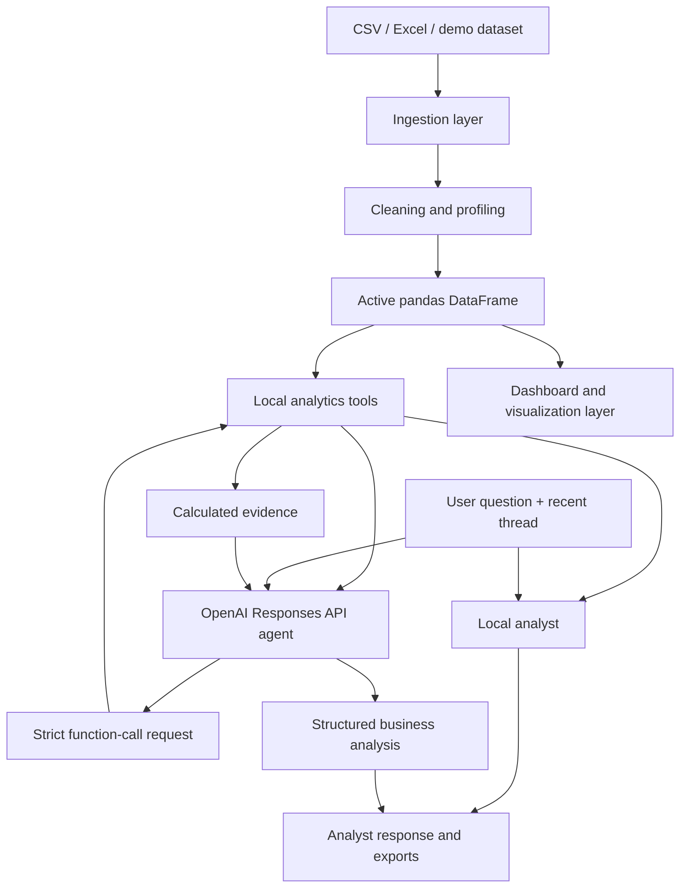

# InsightFlow — Enterprise Business Intelligence & Decision Support

InsightFlow is an individual Business Analytics capstone prototype. It turns an uploaded CSV or Excel dataset into a guided analytical workspace: data profiling, KPI exploration, interactive visualizations, exploratory forecasting, data-quality checks, recommendations, and a conversational analyst that can call a controlled set of Python analytics tools.

> **Project status:** academic prototype. The local analytical mode is available without an API key. The optional OpenAI Responses API agent requires the user's own API key, network access, and explicit consent before analytical context is sent to OpenAI. This repository does not claim production-grade security, autonomous arbitrary SQL/Python execution, or guaranteed forecast accuracy.

## At a glance

- **Data input:** CSV, XLSX and XLS (the first worksheet is read for Excel files).
- **Included examples:** Tesla 2021–2025 annual financial/operational extract and a small illustrative retail sales dataset.
- **Data preparation:** header normalization, duplicate-column removal, empty row/column cleanup, whitespace-to-null normalization, dataset profiling.
- **Visual analytics:** line, area, bar, scatter, histogram, box, violin, pie and treemap charts.
- **Statistical analysis:** descriptive statistics, correlations, IQR outlier screening, year/period comparisons and linear trend extrapolation.
- **Conversational analyst:** twelve strict-schema local analytics tools, structured business responses, bounded tool-calling, optional web research, reasoning/model controls and session-based threads.
- **Exports:** cleaned CSV, filtered/chart data, dataset profile and conversation Markdown.
- **Engineering:** one-click Windows launcher, automatic local port selection, self-test, pytest suite, GitHub Actions and Dependabot configuration.

## Quick start — Windows

1. Install Python 3.11 or newer and ensure the Python Launcher (`py`) is available.
2. Download the repository ZIP from GitHub, or clone it with GitHub Desktop.
3. Extract/open the project folder containing `app.py`.
4. Double-click `START_INSIGHTFLOW.bat`.
5. The launcher checks the Python version and dependencies, installs missing packages (internet required on first setup), runs `self_test.py`, then starts Streamlit on an available local port.
6. Keep the Command Prompt window open while using the app. Stop it with `Ctrl+C`.

### Manual start

From the folder containing `app.py`:

```bash
# Windows
py -m pip install -r requirements.txt
py launch_insightflow.py

# macOS / Linux
python3 -m pip install -r requirements.txt
python3 launch_insightflow.py
```

`launch_insightflow.py` selects a free local port (first tries 8501–8999). Do not start `app.py` directly if you want this port-selection behavior.

## Workspaces

| Workspace | Purpose |
|---|---|
| Executive Overview | Dataset size, numeric-field summaries, overall metrics and basic trend visuals |
| Data Studio | Preview, category filtering and CSV export |
| Visual Explorer | Interactive chart builder with supported Plotly chart types |
| Data Health | Missing values, duplicate rows and IQR outlier screening |
| Forecast Lab | Simple linear-regression trend extrapolation with limitations stated |
| AI Analyst | Local analyst or optional OpenAI Responses API agent with follow-up threads |
| Recommendations | Rule-based signals from the latest two available periods |
| Reports | Dataset profile and conversation/data exports |

## AI Analyst: how it works

InsightFlow uses a **calculation-first, language-model-second** design:

1. The user asks a question in the visible analyst composer.
2. InsightFlow sends the question, recent conversation messages, field metadata and an explicit-consent-controlled analysis context to the selected mode.
3. In LLM mode, the model can request one or more of twelve whitelisted analytics functions. The application executes those functions locally against the active DataFrame.
4. Tool results are returned to the model. The model produces a structured answer containing a direct answer, executive summary, findings, interpretation, business implications, recommendations and limitations.
5. Optional OpenAI web search can add public external context and source links. It is off by default and must be enabled by the user.

The model is **not** allowed to generate arbitrary Python, SQL, shell commands or filesystem operations. Dataset rows are not included in the initial model context; tool functions return bounded calculation results. However, derived values, field metadata, the user's question and recent messages are sent to OpenAI in LLM mode. Do not use LLM mode with confidential data unless the data owner has approved that processing.

### Twelve local analytics tools

`inspect_dataset`, `aggregate_metric`, `compare_periods`, `correlation_matrix`, `forecast_metric`, `categorical_distribution`, `data_quality_report`, `segment_contribution`, `numeric_profile`, `growth_analysis`, `cross_tabulate`, and `ratio_analysis`.

Tools use strict JSON schemas and allowlisted function dispatch. Sensitive dimension names such as email, phone, customer IDs and employee IDs are blocked from grouping/cross-tab operations. These name-based checks are guardrails, not a guarantee that every possible sensitive field is recognized.

### Model and reasoning controls

The sidebar includes model profiles for GPT-6 Astra, GPT-6.1 Sol, GPT-6.1 Terra and GPT-6 Luna, plus a custom model-ID option. It also exposes reasoning effort, standard/pro mode for supported GPT-6 models, response depth, maximum tool rounds, a per-session API-request cap, and optional web search. Actual access depends on the models enabled for the API project. Model capabilities and prices change; consult the official [model catalogue](https://developers.openai.com/api/docs/models) and [API pricing](https://developers.openai.com/api/docs/pricing) before choosing a high-effort or premium model.

The Responses API requests set `store=False` so response application state is not retained by that endpoint for this app. This is not a Zero Data Retention guarantee and does not remove separate abuse-monitoring retention or any hosted-tool-specific data handling; consult the provider's current [data controls documentation](https://developers.openai.com/api/docs/guides/your-data). The app's request cap counts API requests in the active Streamlit session. It is **not** a hard monetary spending limit, does not cap other sessions/users, and may not include separate hosted-tool charges. Set usage budgets and alerts in the OpenAI API project as well.

## API key setup and privacy

Recommended local setup: set `OPENAI_API_KEY` as an operating-system environment variable, or enter the key in the password field in the app for the current Streamlit session. Optionally set `OPENAI_MODEL` to an enabled model ID.

For Streamlit secrets, copy `.streamlit/secrets.toml.example` to `.streamlit/secrets.toml` and replace the placeholder values. The real `secrets.toml` is ignored by Git.

**Never commit an API key.** Do not paste it into source code, README files, screenshots, issues or commits. If a key is exposed, revoke/rotate it immediately. OpenAI recommends environment variables and keeping keys out of repositories: [API key safety guidance](https://help.openai.com/en/articles/5112595-best-practices-for-api-key-safety).

**Public-hosting warning:** do not configure your personal `OPENAI_API_KEY` as a shared secret in a public Streamlit app without authentication, user-level authorization and robust abuse/rate controls. Otherwise, visitors may trigger API usage billed to your account. For a public portfolio demo, leave the shared API key unset; visitors can test the local analytical mode, while LLM users may supply their own key to the session. Treat the app as a demonstration, not a secure multi-tenant service.

## Data and methodology notes

### Tesla demo

`data/Tesla_2021_2025_Company_Data.csv` contains five annual observations and 52 fields. Financial values are generally USD millions; vehicle and infrastructure counts are units; storage deployments are GWh; percentage fields are derived ratios. Blank cells mean the value was not included or verified in this compact extract—not zero. The 2025 geographical revenue split is blank. Employee headcount is not included, so the dataset cannot support employee-concentration or revenue-per-employee questions.

The forecast from five annual values is an exploratory linear trend, not statistically robust company guidance or investment advice. Consult [`docs/TESLA_DATA_NOTES.md`](docs/TESLA_DATA_NOTES.md) and [`docs/DATA_DICTIONARY.md`](docs/DATA_DICTIONARY.md) for source notes and field definitions.

The retail data is a small illustrative sample for trying the application; it is not a verified company's operating data.

## Architecture



See [`docs/AI_AGENT_ARCHITECTURE.md`](docs/AI_AGENT_ARCHITECTURE.md) for the agent loop and security boundaries.

## Project structure and academic evidence

- `app.py` — Streamlit interface and workspace orchestration.
- `insightflow_agent.py` — Responses API agent, strict tool definitions and local analytics dispatch.
- `tests/` — pytest regression tests for the analytics/agent layer.
- `self_test.py` — offline application/data/chart/launcher smoke checks used by the Windows launcher.
- `docs/AI_AGENT_ARCHITECTURE.md` — agent lifecycle and safety design.
- `docs/API_CONFIGURATION_GUIDE.md` — model selection, reasoning settings, tool calling, web search, costs and API-key safety.
- `docs/DATA_DICTIONARY.md` and `docs/TESLA_DATA_NOTES.md` — bundled dataset documentation.
- `docs/EVALUATION_PROTOCOL.md` — repeatable accuracy, privacy and usability evaluation plan.
- `docs/DEVELOPMENT_LOG_TEMPLATE.md` — record your real implementation decisions, failures, fixes and test evidence as you continue developing the capstone.

Before academic submission, add screenshots and your own test outcomes. The template is intentionally blank; do not backdate it or claim experiments that were not performed.

## Run quality checks locally

```bash
python -m pip install -r requirements-dev.txt
python -m compileall -q app.py insightflow_agent.py launch_insightflow.py self_test.py scripts tests
python self_test.py
python -m pytest -q
python -m pip check
python scripts/check_secrets.py
```

The GitHub Actions workflow runs a Python/OS matrix, the self-test, pytest, dependency consistency and the local secret scan. An Ubuntu smoke job launches the actual Streamlit server and checks its health endpoint. Passing CI is evidence for the tested paths, not a proof that every uploaded workbook or live API call will work.

## GitHub and hosting

For a beginner, use **GitHub Desktop** to create and publish the repository, then use **Streamlit Community Cloud** to host the Python application. GitHub stores the source and history; GitHub Pages is for static sites and does not run this Streamlit Python server.

Read [`docs/API_CONFIGURATION_GUIDE.md`](docs/API_CONFIGURATION_GUIDE.md) for model selection, reasoning settings, the twelve analytical tools, web research, API-key safety, usage limits and privacy. Follow [`docs/GITHUB_BEGINNER_GUIDE.md`](docs/GITHUB_BEGINNER_GUIDE.md) before publishing. Streamlit's current deployment flow asks for the repository, branch and entrypoint (because this project is in a subfolder, use `InsightFlow_GitHub_Release/app.py`). Community Cloud supports Python 3.12 by default, which is the recommended deployment choice for this release. See the [official Streamlit deployment guide](https://docs.streamlit.io/deploy/streamlit-community-cloud/deploy-your-app/deploy).

## Known limitations and responsible claims

- Academic prototype, not a production enterprise service.
- CSV and Excel support is file-based; Excel currently reads the first worksheet only.
- No general-purpose relational database connector or automatic multi-table entity resolution.
- No arbitrary code execution or unrestricted natural-language-to-SQL.
- Session-based chat threads are not persisted to a database and may disappear on session/server restart.
- No user authentication, role-based access control, tenant isolation or production-grade rate limiting.
- Sensitive-dimension screening is heuristic and cannot guarantee detection of every personal field.
- Forecasting is exploratory, not a substitute for validated time-series models or business planning.
- LLM answers can still be incorrect. Verify important outputs against the dataset and tool evidence.
- The Tesla sample has five annual records and cannot support robust forecasting or employee-level analysis.

## Academic and authorship note

Use the project as a foundation for your own capstone contribution. Before submission, add your own design decisions, evaluation results, screenshots, limitations and reflection to the report. Do not claim a development timeline, experiments, interviews or features you did not personally perform or verify. A strong viva comes from understanding and defending the implementation, not from overstating its history.


## Public demo

**Live application:** Not deployed yet. This repository contains the source code. A public Streamlit URL will be added here only after deployment completes and the app is smoke-tested.

- **Repository:** https://github.com/krishant0811/InsightFlow-Business-Intelligence
- **Project source folder:** [InsightFlow_GitHub_Release](https://github.com/krishant0811/InsightFlow-Business-Intelligence/tree/main/InsightFlow_GitHub_Release)
- **Application entry point:** [app.py](https://github.com/krishant0811/InsightFlow-Business-Intelligence/blob/main/InsightFlow_GitHub_Release/app.py)

### Deploy on Streamlit Community Cloud

This project is stored inside the `InsightFlow_GitHub_Release` subfolder. When creating the Streamlit app, use:

- Repository: `krishant0811/InsightFlow-Business-Intelligence`
- Branch: `main`
- Main file path: `InsightFlow_GitHub_Release/app.py`

After Streamlit reports a successful deployment and the public page loads, replace the “Not deployed yet” line above with the exact URL supplied by Streamlit. Do not use a guessed URL.

**Public API-key safety:** do not add a personal OpenAI API key as a shared secret to an unauthenticated public app. Leave shared LLM access disabled for the public demo, or implement authentication, per-user authorization, quotas and abuse controls first. Local analytical mode can remain available without a key.

## License

No open-source license has been selected in this repository. Public visibility on GitHub does not automatically grant permission for others to reuse the code. Check your university's project policy and select a license before inviting reuse.
